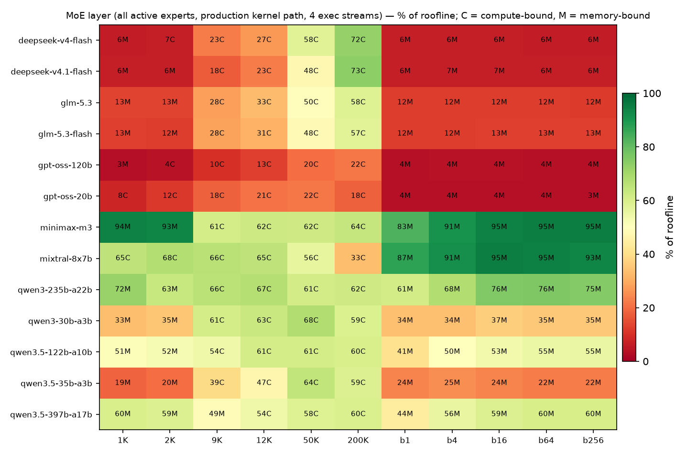
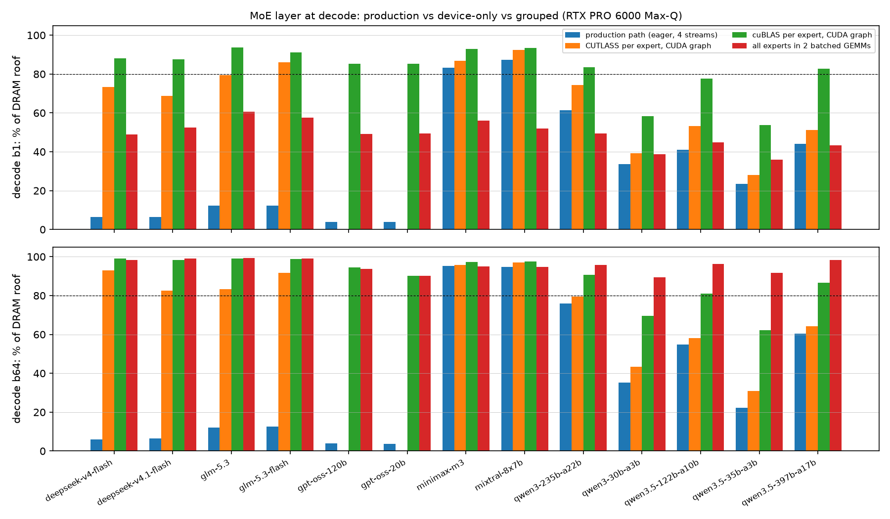
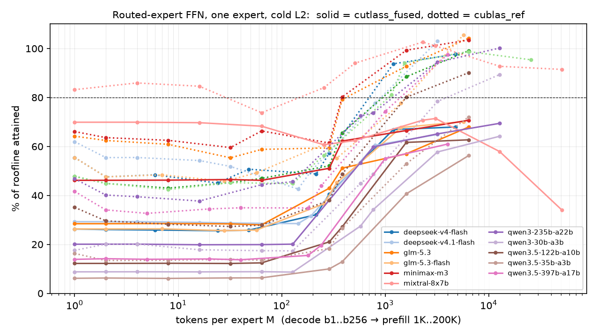
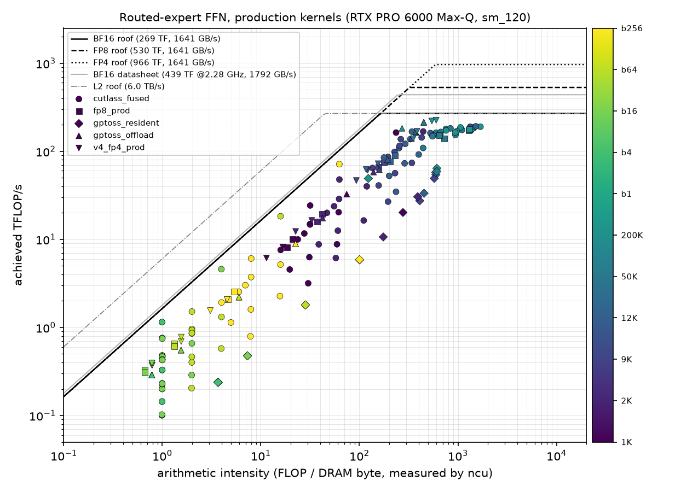

# MoE-Infinity kernel audit on RTX PRO 6000 Blackwell (sm_120)

Date: 2026-11-01. GPU: GPU 5 of this host, **NVIDIA RTX PRO 6000 Blackwell Max-Q Workstation Edition**
(GB202, CC 12.0, 188 SMs, 128 MB L2, 96 GB GDDR7 / 512-bit, 300 W cap, PCIe Gen5). No other process
was on the GPU during any measurement (checked every 25 cases).
Software: `.venv` torch 2.11.0+cu130, Triton 3.6.0, driver 590.48.01, Nsight Compute 2026.3.1.
Audited binaries: the shipped `moe_infinity/_store`, `_paged_attn`, `_v4_fp4` (.so, sm_120 SASS) and
the in-tree Triton kernels, each driven with the real shapes of the latest supported models.

Scripts, summary CSVs and plots: `benchmarks/kernel_audit/`; raw measurements are regenerated by
`run_all.sh` (see §9). Follow-up work is tracked in #297 (sub-issues #298–#318).

---

## 0. The three questions

| Question | Verdict | Evidence (this GPU, real shapes) |
|---|---|---|
| **Batching / long prefill** (compute-bound): is the GPU compute-saturated? | **No, except SDPA-FA2 attention.** | Expert FFN (`fused_moe_ffn_into`, CUTLASS) reaches **41–71 %** of the sustained BF16 roof at 50K–200K tokens, tensor pipe **33–56 %** active. cuBLAS on the *same* shapes gets 53–105 % (tensor pipe 39–85 %), and one batched GEMM over all experts gets 79–96 %. FP8 / FP4 / MXFP4 production paths: 18–73 %. HF eager attention (GPT-OSS, GLM, MiniMax, Mixtral): **2–8 %**, and out of memory from 12K tokens. Only SDPA-FA2 (Qwen3/3.5 shim) is saturated: 84–96 % at ≥ 9K, tensor pipe 70–84 %. |
| **Small batch / decode** (memory-bound): is DRAM bandwidth saturated? | **No.** | A whole MoE layer (production path, 4 exec streams) reaches **3–37 %** of DRAM bandwidth for 8 of the 13 models (GPT-OSS 3–4 %, DeepSeek-V4.x 6–7 %, GLM-5.x 12–13 %, Qwen3.5-35B 22–25 %, Qwen3-30B 34–37 %), 41–76 % for Qwen3.5-122B/397B and Qwen3-235B; only big-expert MiniMax-M3 / Mixtral exceed 80 %. The same weights streamed by 2 batched GEMMs hit **89–99 %** at b64–b256. Decode attention is far worse: `paged_attention_v1` is a one-thread scalar kernel (**1.15 s per layer at 1K context**, 0.0 % of roof), the D = 256 path is a Python loop (0.1 %), HF eager decode is 2–9 %. |
| **Cache reuse maximal?** | **Inside the BF16 GEMM kernels yes; along the op path no.** | CUTLASS reads every weight byte exactly once at decode (DRAM bytes / ideal = **1.00–1.01**) and holds 85–98 % L2 hit at prefill; FA2 holds 85–99.8 % L2 hit. But the paths around them discard reuse: per-call FP8 / MXFP4 / FP4 → BF16 dequant writes and re-reads a BF16 copy (**1.9–8.1×** the ideal DRAM traffic), the 3-kernel gate/up/down split round-trips intermediates (1.1–1.8× at prefill), the Triton MXFP4 GEMM re-reads activations (**up to 34×** at 200K), and GQA K/V are materialised per query head every step (`repeat_kv`: 9–33× in eager decode). |

Headline figures (`results/plots/`):

* `heatmap_expert_layer.png` – MoE layer, % of roofline, model × phase (production path)
* `expert_layer_decode_bars.png` – decode b1/b64: production vs device-only vs grouped GEMM
* `roofline_expert_production.png`, `roofline_expert_cublas.png`, `expert_eff_vs_M.png`
* `heatmap_attn_prefill*.png`, `heatmap_attn_decode_b{1,16,64}*.png`

---

## 1. Roofline ceilings of this GPU (measured)

| Ceiling | Datasheet (Max-Q, 2.28 GHz boost) | Measured | How |
|---|---|---|---|
| BF16 dense tensor | 439 TFLOP/s | **269 TFLOP/s sustained** (308 for short bursts) | cuBLAS 8192³ and 16384×8192², 3 s steady state; SM clock falls to ~1.46 GHz at the 300 W cap |
| FP8 dense tensor | 878 TFLOP/s | 530 TFLOP/s | `torch._scaled_mm` e4m3 |
| NVFP4 dense tensor | 1756 TFLOP/s | 966 TFLOP/s | `torch._scaled_mm` e2m1 + e4m3 block scales |
| DRAM read | 1792 GB/s | **1641 GB/s** | grid-stride read kernel, 4 GiB |
| DRAM copy (r + w) | – | 1463 GB/s | `copy_`, 2 GiB |
| L2 read | – | 6.0 TB/s | `.cg` loads, 32 MiB working set |
| Kernel launch | – | 9.3 µs eager (Python + ATen), 0.94 µs inside a CUDA graph | |

Ridge points: **BF16 164 FLOP/B**, FP8 323, FP4 589. A BF16 expert FFN has arithmetic intensity ≈ M FLOP/B
(M = tokens routed to that expert), so experts are memory-bound below ~160 tokens and compute-bound above:

| phase | tokens per expert M (uniform routing) | regime |
|---|---|---|
| decode b1 … b256 | 1 – 16 (Mixtral up to 64) | memory-bound |
| prefill 1K, 2K | 16 – 128 (Mixtral 256–512) | memory-bound (Mixtral compute) |
| prefill 9K, 12K | 144 – 768 | at / just past the ridge |
| prefill 50K, 200K | 800 – 12 800 | compute-bound |

Single short kernels can run at 2.2–2.3 GHz, so a few compute-bound points read >100 % of the *sustained* roof.
ncu's `sm__pipe_tensor_cycles_active` is the clock-independent compute-saturation number and is reported too.

Small transfers cannot reach the DRAM roof: per-launch overhead (~3 µs between CUDA events), ramp-up and the
tail wave dominate a few-microsecond kernel. The best plain read / copy of the same bytes, timed like the
harness (`size_ceiling.py`, L2 flushed, mean of 200 calls):

| bytes read | 1 MB | 4 MB | 8 MB | 16 MB | 32 MB | 64 MB | 128 MB | 256 MB | 512 MB | 2 GB |
|---|---|---|---|---|---|---|---|---|---|---|
| read, % of 1641 GB/s | 10 | 29 | 44 | 63 | 75 | 84 | 90 | 93 | 95 | 97 |
| copy (read + write same bytes), % of 1463 GB/s | 21 | 65 | 96 | 96 | 99 | 98 | 99 | – | 100 | – |

The copy row counts read + written bytes, but writes are absorbed by the 128 MB write-back L2 within the timed
call, so a small copy costs about as much as a read of the same size. Memory-bound fix gates are judged against
this size-matched ceiling for the same bytes and launch count.

---

## 2. What actually runs on sm_120

Verified in code (file:line) and by kernel names in the ncu captures.

| Op | Production kernel on this box | Models |
|---|---|---|
| Routed experts, BF16 | `fused_moe_ffn_into` (`extensions/kernel/fused_moe_mlp.cu`): 3 separate CUTLASS 2.x `Sm80` GEMMs, 64×64×32 tile, 4 warps, 3 stages, no split-K; one call per active expert, ≤ 4 in flight (4 exec streams) | Qwen3, Qwen3.5, MiniMax-M3, Mixtral, DeepSeek-V2 |
| Routed experts, FP8 store | per-execution `fp8_dequant_blockwise_kernel` ×3 (1 thread / element) → fresh BF16 copy → CUTLASS (`core/parallel/expert_dispatcher.cpp:1520-1535`, `expert_module.cpp:356-379`) | GLM-5.2 / 5.3, GLM-5.3-Flash |
| Routed experts, MXFP4, resident (default) | Python loop over **all** experts with a `token_mask.any()` host sync each; Triton `_fused_mxfp4_gemm_kernel` ×2 + 7 elementwise kernels per hit (`moe_store/wrappers/gpt_oss.py:199-210`) | GPT-OSS 20B / 120B |
| Routed experts, MXFP4, offloaded | per-execution `mxfp4_dequant_kernel` ×2 → cuBLAS + 9 elementwise kernels (`expert_module.cpp:197-222, 295-313`) | GPT-OSS with `device_memory_ratio < 0.9` |
| Routed experts, FP4 | `_v4_fp4.v4_expert_forward`: 3× `fp4_dequant_kernel` → 3× cuBLAS + fp32 clamp/SiLU, sequential Python loop | DeepSeek-V4 / V4.1-Flash |
| Router | torch eager: cuBLAS logits (fp32 SIMT SGEMM for GLM / DeepSeek) + softmax / top-k + `torch.sum(mask).cpu()` sync per layer | all |
| Attention prefill | Qwen3/3.5 paged shim: `repeat_interleave` GQA expansion + SDPA → `pytorch_flash::flash_fwd_kernel` (FA2). Everything else: HF **eager** (flash_attn / flashinfer are not installed, and the loader then forces `eager`, not `sdpa`) | |
| Attention decode | D ≤ 128 (Qwen3): `_paged_attn.paged_attention_v1` – scalar reference kernel, **only thread 0 of each 64-thread block works, O(L·D²)** (`extensions/kernel/paged_attention.cu:35-37, 113-148`). D = 256 (Qwen3.5, MLA): `_paged_attention_sdpa_fallback`, a Python loop over every 16-token block + math-backend SDPA. Others: HF eager over `DynamicCache` | |
| Linear attention | HF torch fallbacks (`torch_chunk_gated_delta_rule`, KDA); fla / causal-conv1d not installed | Qwen3.5 (30 of 40 layers), GLM-5.3-Flash |
| KV-cache write | `PagedAttentionBackend.write_kv`: Python loop per token with `.item()` (`runtime/attention_backend.py:698-715`) | paged-shim models |
| Not on the hot path | Triton `fused_ffn`, `fused_qkv_proj`, `fused_decode_attention`, Triton router, `_store.topk_softmax`, sgl_kernel route | – |

---

## 3. Routed-expert FFN

### 3.1 MoE layer, production path

All active experts of one layer, 4 exec streams as in `ExpertDispatcher`, distinct (cold) weights per expert,
uniform routing. Roofline per layer = max(FLOPs / 269 TF, bytes / 1641 GB/s), with bytes = weights of every
active expert *in the checkpoint's format* + activations. C = compute-bound point, M = memory-bound point.

| model (production impl) | 1K | 2K | 9K | 12K | 50K | 200K | b1 | b4 | b16 | b64 | b256 |
|---|---|---|---|---|---|---|---|---|---|---|---|
| qwen3.5-35b-a3b (cutlass_fused) | 19% M | 20% M | 39% C | 47% C | 64% C | 59% C | 24% M | 25% M | 24% M | 22% M | 22% M |
| qwen3.5-122b-a10b (cutlass_fused) | 51% M | 52% M | 54% C | 61% C | 61% C | 60% C | 41% M | 50% M | 53% M | 55% M | 55% M |
| qwen3.5-397b-a17b (cutlass_fused) | 60% M | 59% M | 49% M | 54% C | 58% C | 60% C | 44% M | 56% M | 59% M | 60% M | 60% M |
| qwen3-30b-a3b (cutlass_fused) | 33% M | 35% M | 61% C | 63% C | 68% C | 59% C | 34% M | 34% M | 37% M | 35% M | 35% M |
| qwen3-235b-a22b (cutlass_fused) | 72% M | 63% M | 66% C | 67% C | 61% C | 62% C | 61% M | 68% M | 76% M | 76% M | 75% M |
| gpt-oss-20b (gptoss_resident) | 8% C | 12% C | 18% C | 21% C | 22% C | 18% C | 4% M | 4% M | 4% M | 4% M | 3% M |
| gpt-oss-120b (gptoss_resident) | 3% M | 4% C | 10% C | 13% C | 20% C | 22% C | 4% M | 4% M | 4% M | 4% M | 4% M |
| glm-5.3 (fp8_prod) | 13% M | 13% M | 28% C | 33% C | 50% C | 58% C | 12% M | 12% M | 12% M | 12% M | 12% M |
| glm-5.3-flash (fp8_prod) | 13% M | 12% M | 28% C | 31% C | 48% C | 57% C | 12% M | 12% M | 13% M | 13% M | 13% M |
| deepseek-v4-flash (v4_fp4_prod) | 6% M | 7% C | 23% C | 27% C | 58% C | 72% C | 6% M | 6% M | 6% M | 6% M | 6% M |
| deepseek-v4.1-flash (v4_fp4_prod) | 6% M | 6% M | 18% C | 23% C | 48% C | 73% C | 6% M | 7% M | 7% M | 6% M | 6% M |
| minimax-m3 (cutlass_fused) | 94% M | 93% M | 61% C | 62% C | 62% C | 64% C | 83% M | 91% M | 95% M | 95% M | 95% M |
| mixtral-8x7b (cutlass_fused) | 65% C | 68% C | 66% C | 65% C | 56% C | 33%¹ C | 87% M | 91% M | 95% M | 95% M | 93% M |

¹ Mixtral routes M = 12 800 (50K) and 51 200 (200K) tokens to one expert, above the engine's `kMaxTokens = 8192`,
so the native engine would abort there; shown for completeness.



### 3.2 What is reachable on this GPU with the same weights

Per-layer time (and % of the roofline for that variant's weight format). "Graph" columns replay the
per-expert kernels inside a CUDA graph on 4 streams, i.e. device time without host launch overhead; the last
variant runs all active experts as two cuBLAS batched GEMMs (a grouped-GEMM proxy, BF16).

| model | point | production path | CUTLASS / expert (graph) | cuBLAS / expert (graph) | all experts, 2 batched GEMMs | roofline (BF16 bytes) |
|---|---|---|---|---|---|---|
| qwen3.5-35b-a3b | b1 | 130 µs (24%) | 109 µs (28%) | 57 µs (54%) | 86 µs (36%) | 31 µs |
| qwen3.5-35b-a3b | b64 | 3.8 ms (22%) | 2.8 ms (31%) | 1.4 ms (62%) | 932 µs (92%) | 853 µs |
| qwen3.5-35b-a3b | 12K | 4.9 ms (47%) | – | – | 2.7 ms (85%) | 2.3 ms |
| qwen3.5-35b-a3b | 200K | 65.2 ms (59%) | – | – | 48.6 ms (79%) | 38.4 ms |
| qwen3-30b-a3b | b1 | 137 µs (34%) | 117 µs (39%) | 79 µs (58%) | 119 µs (39%) | 46 µs |
| qwen3-30b-a3b | b64 | 2.1 ms (35%) | 1.7 ms (43%) | 1.0 ms (70%) | 813 µs (89%) | 727 µs |
| qwen3-235b-a22b | b1 | 300 µs (61%) | 247 µs (74%) | 220 µs (83%) | 373 µs (49%) | 184 µs |
| qwen3-235b-a22b | b64 | 3.8 ms (76%) | 3.7 ms (79%) | 3.2 ms (91%) | 3.0 ms (96%) | 2.9 ms |
| qwen3-235b-a22b | 12K | 20.6 ms (67%) | – | – | 13.9 ms (100%) | 13.8 ms |
| qwen3-235b-a22b | 200K | 372.4 ms (62%) | – | – | 259.8 ms (89%) | 230.1 ms |
| qwen3.5-397b-a17b | b64 | 9.3 ms (60%) | 8.8 ms (64%) | 6.5 ms (87%) | 5.7 ms (98%) | 5.6 ms |
| gpt-oss-120b | b1 | 829 µs (4%) | – | 142 µs (85%) | 247 µs (49%) | 121 µs |
| gpt-oss-120b | b64 | 23.0 ms (4%) | – | 3.6 ms (95%) | 3.6 ms (94%) | 3.4 ms |
| gpt-oss-120b | 12K | 72.6 ms (13%) | – | – | 9.9 ms (92%) | 9.1 ms |
| glm-5.3 | b1 | 1.5 ms (12%) | 464 µs (79%) | 393 µs (94%) | 608 µs (61%) | 368 µs |
| glm-5.3 | b64 | 42.1 ms (12%) | 12.3 ms (83%) | 10.3 ms (99%) | 10.3 ms (99%) | 10.2 ms |
| glm-5.3 | 12K | 83.4 ms (33%) | – | – | 31.4 ms (88%) | 27.6 ms |
| deepseek-v4-flash | b1 | 770 µs (6%) | 251 µs (73%) | 209 µs (88%) | 377 µs (49%) | 184 µs |
| deepseek-v4-flash | b64 | 27.1 ms (6%) | 6.6 ms (93%) | 6.2 ms (99%) | 6.2 ms (98%) | 6.1 ms |
| minimax-m3 | b1 | 332 µs (83%) | 318 µs (87%) | 297 µs (93%) | 494 µs (56%) | 276 µs |
| minimax-m3 | 200K | 540.3 ms (64%) | – | – | 359.5 ms (96%) | 345.2 ms |

The full table for all 13 models is in `results/summary_expert_grouped.csv` / `summary_expert_layer_graph.csv`.
Reading it: the FP8 / FP4 / MXFP4 production paths are **3–7× slower than plain BF16 kernels on the BF16
weights** at decode, even though they move 2–4× fewer bytes; a native low-precision grouped kernel would be
another 2–3.8× below the BF16 roofline column.



### 3.3 Why: per-kernel ncu diagnostics (one expert, cold L2)

| model | point | impl | t (µs) | grid (main kernel) | waves | warps active % | tensor pipe % | DRAM BW % | DRAM bytes / ideal | L2 hit % |
|---|---|---|---|---|---|---|---|---|---|---|
| qwen3.5-35b-a3b | b1 (M=1) | cutlass_fused | 62 | 8 | 0.01 | 8 | 2 | 7 | 1.01 | 40 |
| qwen3.5-35b-a3b | b1 (M=1) | cublas_ref | 24 | 256 | 0.45 | 12 | 0 | 22 | 1.01 | 65 |
| qwen3.5-35b-a3b | 200K (M=6400) | cutlass_fused | 266 | 800 | 1.06 | 32 | 43 | 16 | 1.22 | 92 |
| qwen3.5-35b-a3b | 200K (M=6400) | cublas_ref | 208 | 600 | 3.19 | 23 | 53 | 17 | 1.00 | 79 |
| qwen3-235b-a22b | b1 (M=1) | cutlass_fused | 115 | 24 | 0.03 | 8 | 6 | 23 | 1.00 | 35 |
| qwen3-235b-a22b | b1 (M=1) | cublas_ref | 49 | 384 | 1.02 | 29 | 0 | 53 | 1.00 | 25 |
| qwen3-235b-a22b | 200K (M=12800) | cutlass_fused | 2589 | 12800 | 17.02 | 33 | 56 | 10 | 1.84 | 97 |
| qwen3-235b-a22b | 200K (M=12800) | cublas_ref | 1794 | 1600 | 8.51 | 21 | 81 | 16 | 2.01 | 88 |
| gpt-oss-120b | b1 (M=1) | gptoss_resident | 209 | 180 | 0.24 | 8 | 3 | 4 | 1.02 | 27 |
| gpt-oss-120b | 200K (M=6400) | gptoss_resident | 4978 | 4500 | 5.98 | 34 | 15 | 6 | 6.00 | 93 |
| gpt-oss-20b | 200K (M=25600) | gptoss_resident | 25928 | 18000 | 23.94 | 36 | 15 | 26 | 33.56 | 72 |
| glm-5.3 | b1 (M=1) | fp8_prod | 229 | 32 | 0.04 | 40 | 4 | 27 | 3.00 | 30 |
| glm-5.3 | 200K (M=6400) | fp8_prod | 2780 | 3200 | 4.26 | 35 | 51 | 8 | 1.92 | 94 |
| deepseek-v4-flash | b1 (M=1) | v4_fp4_prod | 135 | 16384² | 14.52 | 54 | 0 | 26 | 4.78 | 22 |
| minimax-m3 | b1 (M=1) | cutlass_fused | 150 | 48 | 0.13 | 8 | 15 | 58 | 1.00 | 2 |
| minimax-m3 | 200K (M=6400) | cutlass_fused | 3814 | 4800 | 12.77 | 16 | 55 | 7 | 1.58 | 98 |

² the longest kernel is the FP4 dequant, not the GEMM. Full table for every model and point:
`results/tables_expert.md`; per-kernel records: `results/ncu_expert.jsonl` (regenerated by
`run_all.sh expert_ncu`).

Breakdown of the slow production paths (single expert, decode, ncu):

| path | kernels per expert | where the time goes |
|---|---|---|
| GLM-5.3 `fp8_prod` (229 µs) | 3 dequant + 3 GEMM | 3 × 37 µs `fp8_dequant_blockwise_kernel` at 339 GB/s (20 % BW), then CUTLASS on 32 CTAs |
| GPT-OSS `gptoss_offload` (172 µs) | 2 dequant + 2 GEMM + 9 elementwise | `mxfp4_dequant_kernel` 67 + 34 µs at 130 GB/s (8 % BW); the cuBLAS GEMMs themselves run at 1.0–1.3 TB/s |
| GPT-OSS `gptoss_resident` (209 µs) | 2 Triton GEMM + 7 elementwise | `_fused_mxfp4_gemm_kernel` 100 µs (gate/up) + 99 µs (down) at 45–88 GB/s (3–5 % BW), 90–180 CTAs, BLOCK_K = 32 |
| DeepSeek-V4 `v4_fp4_prod` (135 µs) | 3 dequant + 3 GEMM + 7 elementwise | 3 × 26.6 µs `fp4_dequant_kernel` at 168 GB/s (10 % BW) |




Findings:

1. **Decode is parallelism-starved, not bandwidth-starved.** The CUTLASS GEMMs launch N/64 CTAs
   (8 for Qwen3.5-35B gate/up, 12 Qwen3-30B, 24 Qwen3-235B, 32 GLM / DeepSeek, 48 MiniMax) on 188 SMs:
   0.01–0.13 waves, 8 % of warp slots active. Each GEMM reads each weight byte exactly once (DRAM bytes /
   ideal = 1.00) but pulls only 100–550 GB/s. The 64-row M tile also executes 64× the useful MMA work at
   M = 1. cuBLAS picks a GEMV-style kernel (192–3584 CTAs) and is 1.2–3.0× faster per expert; but no
   per-expert kernel can fill the GPU on a 6–50 MB expert: the fix is one grouped/persistent kernel over all
   active experts of a layer (measured proxy above: 89–99 % at b64–b256).
2. **Prefill GEMMs are under-tiled.** At M ≥ 1600 the 64×64×32, 4-warp tile caps occupancy at 16 of 48
   warps and the tensor pipe at 33–56 %, and wave quantisation adds loss (800 CTAs = 1.06 waves for
   Qwen3.5-35B at 200K). cuBLAS (256×128 tiles, 8 warps, 75 KB smem) reaches 67–85 % tensor-pipe on the same
   problems and is **1.3–1.5× faster**.
3. **Low-precision weights are de-quantised to BF16 on every expert call.** The dequant kernels are
   one-thread-per-element streaming kernels at 130–340 GB/s, and the round trip triples the traffic (GLM
   3.0×, GPT-OSS offload 4.8×, DeepSeek-V4 4.8× the ideal bytes). sm_120 has native FP8 and block-scaled FP4
   MMA (530 / 966 TF measured) that none of these paths use.
4. **The GPT-OSS resident Triton MXFP4 GEMM is the slowest expert kernel audited**: 45–100 GB/s at decode,
   15 % tensor pipe at prefill, and 6–34× activation re-reads at large M (the grid walks M fastest, so X tiles
   are not reused from L2). Its autotune key includes M, so each new per-expert token count costs 0.68–0.96 s
   of autotuning the first time. The wrapper around it adds a host sync per expert per layer: with the real
   loop the GPT-OSS-120B MoE layer takes **2.8 ms at b1** (expert kernels alone 0.83 ms, roofline 32 µs,
   GPU busy 38 %) – see §5.
5. **Real routing** (captured Qwen3-30B-A3B trace, layers 0 / 24 / 47): per-expert token counts are skewed
   (max/mean 3.7–7× at 1K–2K prefill) and decode touches fewer experts than uniform routing predicts
   (b64: 57–80 active vs 126; b256: 79–102 vs 128). Layer time tracks the number of active experts, and the
   per-expert efficiency equals the balanced case within ±2 %. Uniform routing therefore overstates decode
   expert *work* at b64–b256 by up to 1.6× but not the inefficiency.

---

## 4. Attention

### 4.1 Prefill (one sequence, causal, per layer)

Roof = `T²·H·(d_qk + d_v)` FLOPs at 269 TF. `sdpa_gqa` is the same FA2 kernel with native GQA (no K/V copy).

| model | path | 1K | 2K | 9K | 12K | 50K | 200K |
|---|---|---|---|---|---|---|---|
| qwen3.5-35b-a3b | sdpa_shim | 111 µs (29%) | 226 µs (56%) | 3.1 ms (84%) | 5.3 ms (88%) | 89.9 ms (89%) | 1.64 s (78%) |
| qwen3.5-35b-a3b | sdpa_gqa | 90 µs (35%) | 190 µs (67%) | 2.9 ms (89%) | 5.0 ms (92%) | 88.8 ms (90%) | 1.64 s (78%) |
| qwen3.5-122b-a10b | sdpa_shim | 144 µs (44%) | 405 µs (63%) | 6.0 ms (86%) | 10.3 ms (89%) | 182.7 ms (87%) | 3.31 s (77%) |
| qwen3.5-397b-a17b | sdpa_shim | 145 µs (44%) | 403 µs (63%) | 6.0 ms (86%) | 10.3 ms (89%) | 182.9 ms (87%) | 3.31 s (77%) |
| qwen3-30b-a3b | sdpa_shim | 93 µs (34%) | 226 µs (57%) | 2.9 ms (88%) | 5.0 ms (92%) | 84.4 ms (95%) | 1.34 s (96%) |
| qwen3-235b-a22b | sdpa_shim | 149 µs (43%) | 397 µs (64%) | 5.7 ms (91%) | 9.7 ms (95%) | 170.0 ms (94%) | 2.67 s (96%) |
| qwen3-235b-a22b | sdpa_gqa | 109 µs (59%) | 324 µs (79%) | 5.3 ms (98%) | 9.2 ms (100%) | 167.4 ms (95%) | 2.66 s (96%) |
| gpt-oss-120b | hf_eager | 1.5 ms (2%) | 6.2 ms (2%) | 115.4 ms (2%) | OOM | OOM | OOM |
| gpt-oss-120b | sdpa_gqa³ | 66 µs (49%) | 176 µs (73%) | 2.9 ms (91%) | 4.7 ms (97%) | 84.0 ms (95%) | 1.34 s (95%) |
| glm-5.3 (MLA, eager) | hf_eager | 1.6 ms (8%) | 6.4 ms (8%) | 138.8 ms (7%) | OOM | OOM | OOM |
| glm-5.3 | sdpa_gqa | 195 µs (66%) | 649 µs (79%) | 11.8 ms (87%) | 19.8 ms (93%) | 361.4 ms (88%) | 6.62 s (77%) |
| minimax-m3 | hf_eager | 2.0 ms (3%) | 6.0 ms (4%) | 129.6 ms (4%) | OOM | OOM | OOM |
| minimax-m3 | sdpa_gqa | 109 µs (59%) | 324 µs (79%) | 5.6 ms (92%) | 9.2 ms (100%) | 167.2 ms (96%) | 2.66 s (96%) |
| mixtral-8x7b | hf_eager | 629 µs (5%) | 3.0 ms (4%) | 64.7 ms (4%) | 115.2 ms (4%) | OOM | OOM |
| mixtral-8x7b | sdpa_gqa | 74 µs (43%) | 189 µs (67%) | 2.9 ms (89%) | 5.0 ms (92%) | 83.0 ms (96%) | 1.33 s (96%) |

³ GPT-OSS needs attention sinks, which plain SDPA does not implement; the row shows the cost floor of an FA2-class
kernel at these shapes.

* **SDPA-FA2 is compute-saturated** from 9K: tensor pipe 70–84 % active, L2 hit 85–99.8 %, 84–96 % of the
  sustained roof (D = 128) and 77–89 % (D = 256, whose clock drops to ~1.39 GHz at 200K under the power cap).
  At 1K–2K the kernel is short and reaches 29–64 %.
* The shim's `repeat_interleave` GQA copy costs 20–35 % at 1K–2K and 1–6 % from 9K.
* **HF eager attention is 8–40× slower than FA2** (2–8 % of roof) and needs O(H·T²) memory: one GPT-OSS
  layer at 9K moves **151 GB** through DRAM (softmax over a 64 × 9216 × 9217 tensor), and 12K tokens no longer fit
  (64-head models; Mixtral fails at 50K). 50K / 200K prefill is impossible on this path for GPT-OSS, GLM-5.x,
  MiniMax-M3 and Mixtral.
* Qwen3.5 / GLM-5.3-Flash linear-attention layers use the torch fallback: **6.0 ms (1K), 7.5 ms (2K),
  20.9 ms (9K) per layer**, 30 such layers in Qwen3.5-35B.

### 4.2 Decode (per layer)

Roof = KV-cache bytes / 1641 GB/s. `triton_decode` (in-tree, not wired) and `sdpa_flash_decode` (torch
split-KV flash-decoding on a contiguous cache) show what is reachable.

**B = 1**

| model | path | 1K | 2K | 9K | 12K | 50K | 200K |
|---|---|---|---|---|---|---|---|
| qwen3.5-35b-a3b | sdpa_fallback (prod) | 1.2 ms (0.1%) | – | 9.3 ms (0.1%) | – | 61.6 ms (0.1%) | 277.3 ms (0.1%) |
| qwen3.5-35b-a3b | sdpa_flash_decode | 17 µs (8%) | 23 µs (11%) | 37 µs (31%) | 49 µs (31%) | 113 µs (57%) | 331 µs (77%) |
| qwen3.5-397b-a17b | sdpa_fallback (prod) | 1.4 ms (0.1%) | – | 11.2 ms (0.1%) | – | 59.9 ms (0.1%) | 321.0 ms (0.1%) |
| qwen3-30b-a3b | paged_v1 (prod) | 1.15 s (0.0%) | 2.31 s (0.0%) | 10.39 s (0.0%) | – | – | – |
| qwen3-235b-a22b | paged_v1 (prod) | 1.15 s (0.0%) | 2.31 s (0.0%) | 10.39 s (0.0%) | – | – | – |
| qwen3-235b-a22b | triton_decode | 110 µs (1%) | 134 µs (2%) | 436 µs (3%) | 568 µs (3%) | 2.1 ms (3%) | 8.2 ms (3%) |
| qwen3-235b-a22b | sdpa_flash_decode | 16 µs (8%) | 18 µs (14%) | 37 µs (31%) | 41 µs (37%) | 96 µs (66%) | 297 µs (86%) |
| gpt-oss-120b | hf_eager_decode (prod) | 66 µs (2%) | 90 µs (3%) | 291 µs (4%) | 377 µs (4%) | 1.4 ms (4%) | 5.7 ms (5%) |
| gpt-oss-120b | sdpa_flash_decode | 14 µs (9%) | 18 µs (14%) | 33 µs (35%) | 37 µs (42%) | 89 µs (72%) | 289 µs (89%) |
| glm-5.3 | hf_eager_decode (prod) | 95 µs (43%) | 172 µs (48%) | 735 µs (50%) | 934 µs (53%) | 2.7 ms (75%) | 11.0 ms (75%) |
| minimax-m3 | hf_eager_decode (prod) | 83 µs (2%) | 113 µs (2%) | 481 µs (2%) | 639 µs (2%) | 2.6 ms (2%) | 12.8 ms (2%) |
| mixtral-8x7b | hf_eager_decode (prod) | 61 µs (4%) | 78 µs (7%) | 273 µs (8%) | 337 µs (9%) | 1.5 ms (9%) | 6.5 ms (8%) |

**B = 16**

| model | path | 1K | 2K | 9K | 12K | 50K | 200K |
|---|---|---|---|---|---|---|---|
| qwen3.5-35b-a3b | sdpa_fallback (prod) | 15.0 ms (0.1%) | – | 169.9 ms (0.1%) | – | – | – |
| qwen3.5-35b-a3b | sdpa_flash_decode | 37 µs (56%) | 61 µs (67%) | 213 µs (86%) | 276 µs (89%) | 1.1 ms (95%) | 4.2 ms (98%) |
| qwen3-235b-a22b | paged_v1 (prod) | 1.52 s (0.0%) | – | – | – | – | – |
| qwen3-235b-a22b | triton_decode | 224 µs (9%) | 367 µs (11%) | 1.3 ms (14%) | 1.8 ms (14%) | 7.2 ms (14%) | 33.3 ms (12%) |
| qwen3-235b-a22b | sdpa_flash_decode | 36 µs (58%) | 66 µs (63%) | 211 µs (87%) | 278 µs (88%) | 1.1 ms (95%) | 4.2 ms (98%) |
| gpt-oss-120b | hf_eager_decode (prod) | 492 µs (4%) | 927 µs (4%) | 3.9 ms (5%) | 5.2 ms (5%) | 23.3 ms (4%) | 95.7 ms (4%) |
| minimax-m3 | hf_eager_decode (prod) | 885 µs (2%) | 1.7 ms (2%) | 7.3 ms (3%) | 9.8 ms (3%) | 44.8 ms (2%) | OOM |
| mixtral-8x7b | hf_eager_decode (prod) | 485 µs (8%) | 933 µs (9%) | 3.9 ms (9%) | 5.2 ms (9%) | 23.1 ms (9%) | 96.7 ms (8%) |

* **`paged_attention_v1` is unusable**: 1.15 s (b1, 1K) → 10.4 s (b1, 9K) **per layer** – ~5 orders of
  magnitude off the flash-decoding reference. Qwen3-235B would need ~108 s per generated token at 1K context.
* The D = 256 fallback (Qwen3.5, padded MLA) costs 1.2–321 ms per layer at b1, 0.1 % of roof, entirely
  host-bound (one Python iteration per 16-token block).
* HF eager decode copies the whole cache through `repeat_kv` every step: 2–9 % of roof for the GQA models
  (MiniMax 16:1, GPT-OSS 8:1, Mixtral 4:1) and OOM at large B·L. GLM-5.3 (MHA, no expansion) reaches 43–97 %.
* The in-tree Triton `fused_decode_attention` has no split-KV (grid = B × H), so b1 long context runs on
  16–64 CTAs (1–3 % of roof at b1, ≤ 48 % at b64). It also uses 32-bit offsets and **faults with an illegal
  address once the KV pool exceeds 2³¹ elements** (reproduced: Mixtral b256 @ 9K).
* Flash-decoding reaches 77–98 % of DRAM BW from 50K context or B ≥ 16. At b1 / 1K–2K the whole layer is
  1–3 µs of traffic, so ~15 µs of launch + combine latency dominates (8–14 %): a CUDA graph is what helps there.

ncu on the decode kernels (DRAM bytes / ideal KV bytes, achieved DRAM BW):

| path | b1 @ 9K | b16 @ 9K | b64 @ 50K / b1 @ 200K | reading |
|---|---|---|---|---|
| HF eager (GPT-OSS, 8:1 GQA) | 12.4×, 0.9 TB/s | 17.1×, 1.3 TB/s | 17.5×, 1.4 TB/s | DRAM is busy, but on `repeat_kv` copies: bandwidth-bound on 12–17× the necessary bytes |
| HF eager (MiniMax-M3, 16:1) | 29.0×, 1.2 TB/s | 32.9×, 1.4 TB/s | 33.1×, 1.4 TB/s | same, 29–33× |
| HF eager (GLM-5.3, MHA) | 1.03×, 1.3 TB/s | 1.02×, 1.6 TB/s | 1.02×, 1.3 TB/s | no expansion, so near the roof |
| Triton `fused_decode_attention` | 1.00×, 52–59 GB/s (32–64 CTAs) | 1.1–1.35×, 0.3–0.45 TB/s | 3.3–9.3×, 1.3–1.5 TB/s | b1: too few CTAs; large B: each query head re-reads its KV head once the pool outgrows L2 (L2 hit 42–58 %) |
| SDPA flash-decoding (split-KV) | 1.04–1.13×, 0.4–0.5 TB/s | 1.02–1.04×, 1.5 TB/s | 1.00–1.02×, 1.2–1.6 TB/s | saturated and no redundant traffic; b1 @ 9K is latency-bound (≈ 3 µs of data) |

---

## 5. Small ops and host-bound paths

| op (per layer) | b1 decode | 1K prefill | 200K prefill | note |
|---|---|---|---|---|
| Router, bf16 (Qwen3.5-35B) | 74 µs | 102 µs | 3.6 ms | ~8 launches + `torch.sum(mask).cpu()`; ≥ 70 µs floor even for one token |
| Router, fp32 (GLM-5.3) | 90 µs | 242 µs | 24.3 ms | fp32 SIMT SGEMM, no tensor cores |
| KV write loop (Qwen3-235B) | 73 µs | 25.3 ms | ≈ 5.1 s (25 µs / token, extrapolated) | `.item()` per token per layer |
| GDN linear attention (Qwen3.5-35B) | – | 6.0 ms | ≈ 0.45 s (extrapolated from 1K / 2K / 9K) | torch chunked fallback |
| GPT-OSS-120B MoE layer, real wrapper loop | 2.8 ms | 52.2 ms | – | 128 × `token_mask.any()` sync + Triton MXFP4; kernels alone 0.83 / 33.6 ms; roofline 32 µs / 1.0 ms |

GPU-busy fraction = Σ kernel time (CUPTI, `torch.profiler`) / unprofiled wall time, one stream. Below ~50 %
the GPU is idle waiting for the host, so no kernel change can saturate it:

| path | point | wall | kernel time | GPU busy | launches |
|---|---|---|---|---|---|
| D = 256 decode fallback (Qwen3.5-35B) | b1 @ 9K | 9.3 ms | 2.4 ms | **25 %** | 609 |
| D = 256 decode fallback (Qwen3.5-35B) | b16 @ 9K | 170 ms | 36 ms | **21 %** | 9 699 |
| KV write loop (Qwen3-235B) | 1K tokens | 25.3 ms | 5.8 ms | **23 %** | 3 072 |
| GDN torch fallback (Qwen3.5-35B) | 9K | 20.9 ms | 14.6 ms | 70 % | 2 878 |
| Router, bf16 | b1 | 74 µs | 25 µs | **34 %** | 12 |
| GPT-OSS-120B MoE layer, real loop | b1 | 2.8 ms | 1.06 ms | **38 %** | 393 |
| GPT-OSS-120B MoE layer, real loop | 1K | 52 ms | 35 ms | 68 % | 4 750 |
| `paged_attention_v1` | b1 @ 1K | 1.15 s | 1.16 s | 100 % | 2 |
| HF eager decode (GPT-OSS) | b1 @ 9K | 291 µs | 289 µs | 99 % | 9 |

The last two are GPU-bound, but on the wrong work: a scalar kernel, and 12× redundant `repeat_kv` traffic.

**Triton autotune on the hot path.** `_fused_mxfp4_gemm_kernel` is autotuned with `key=["M","N","K"]`. The first
call with a token count the process has not seen costs **0.68–0.96 s** (measured for M = 1, 37, 41, 53, 97,
211, 1009) against 0.09–0.57 ms afterwards. Prefill produces a different M for almost every expert, so early
GPT-OSS prefills pay this many times over.

---

## 6. Where a step's time goes

Measured per-layer times × layer counts (production paths; attention layers = full + sliding; KV write only for
paged-shim models; "n/m" = not measured: DeepSeek-V4 attention is tilelang code outside this repo, GDN decode
was not measured). The roofline column covers experts + attention + router only.

| model | phase | routed experts | attention | router | KV write | linear attn | **measured step** | roofline step |
|---|---|---|---|---|---|---|---|---|
| qwen3.5-35b-a3b | decode b1 @ 9K | 5.2 ms | 93.1 ms | 3.0 ms | 447 µs | n/m | **101.8 ms** | 1.4 ms |
| qwen3.5-35b-a3b | prefill 12K | 195.0 ms | 52.5 ms | 11.0 ms | 3.14 s | 837.3 ms | **4.24 s** | 140.0 ms |
| qwen3-235b-a22b | decode b1 @ 9K | 28.2 ms | 977.10 s | 7.0 ms | 6.8 ms | – | **977.14 s** | 18.4 ms |
| qwen3-235b-a22b | prefill 12K | 1.94 s | 915.1 ms | 20.5 ms | 28.58 s | – | **31.45 s** | 2.17 s |
| gpt-oss-120b | decode b1 @ 9K | 29.9 ms (100 ms with the real loop) | 10.5 ms | 2.5 ms | – | – | **42.8 ms (113 ms)** | 1.6 ms |
| gpt-oss-120b | prefill 12K | 2.61 s | OOM | 7.2 ms | – | – | **OOM** | 329.2 ms |
| glm-5.3 | decode b1 @ 9K | 112.1 ms | 57.3 ms | 6.8 ms | – | – | **176.2 ms** | 42.8 ms |
| glm-5.3 | prefill 12K | 6.25 s | OOM | 110.4 ms | – | – | **OOM** | 2.08 s |
| deepseek-v4-flash | decode b1 @ 9K | 33.1 ms | n/m | 3.5 ms | – | – | **≥ 36.7 ms** | 2.2 ms |
| deepseek-v4-flash | prefill 12K | 2.21 s | n/m | 42.4 ms | – | – | **≥ 2.25 s** | 597.9 ms |
| minimax-m3 | decode b1 @ 9K | 19.9 ms | 28.9 ms | 4.1 ms | – | – | **52.9 ms** | 17.3 ms |
| minimax-m3 | prefill 12K | 1.99 s | OOM | 15.7 ms | – | – | **OOM** | 1.25 s |

So the kernel that limits each model today is: decode attention (Qwen3, Qwen3.5), the KV write loop and GDN
fallback (prefill of the paged-shim models), eager attention (OOM for everyone else at ≥ 12K), and the
de-quantising expert paths (GLM, DeepSeek-V4, GPT-OSS).

---

## 7. Fixes, in priority order

Expected gains are measured on this GPU with the reference kernels above (same shapes), not estimated.

| # | change | where | measured effect |
|---|---|---|---|
| P0-1 | Replace `paged_attention_v1` and the D = 256 Python fallback with a split-KV paged decode kernel (FlashInfer `BatchDecodeWithPagedKVCache` supports sm_120 and D = 64/128/256; or vLLM v2-style; or fix the in-tree Triton kernel: split-KV + int64 offsets) | `extensions/kernel/paged_attention.cu`, `kernel/paged_attention_ops.py:139-283` | b1 @ 9K per layer: 10.4 s → 37 µs (Qwen3), 9.3 ms → 37 µs (Qwen3.5); 77–98 % of DRAM BW from 50K or B ≥ 16 |
| P0-2 | Vectorise `write_kv` (one `index_put_` / the existing Triton `paged_kv_write_`) | `runtime/attention_backend.py:698-715` | 25 µs per token per layer → one launch per layer; removes 28.6 s from a Qwen3-235B 12K prefill |
| P0-3 | Use `attn_implementation="sdpa"` instead of `eager` when flash_attn is missing (Mixtral, MiniMax-M3, GLM), and a sink-capable FA kernel for GPT-OSS | `entrypoints/big_modeling.py:304-338`, `runtime/model_offload.py:1415-1430` | 8–40× faster prefill, no O(H·T²) memory: 12K–200K become possible (84–96 % of roof) |
| P0-4 | Install fla + causal-conv1d (or port the chunked GDN/KDA kernels) | env | GDN layer at 9K: 20.9 ms of Python-driven small kernels today |
| P1-5 | One grouped kernel per MoE layer instead of 3 GEMMs × active experts (CUTLASS grouped GEMM / persistent Triton fused-MoE with the sorted-token layout) | `extensions/kernel/fused_moe_mlp.cu`, `core/parallel/expert_dispatcher.cpp` | decode b64–b256: 22–76 % → 89–99 % of BW (Qwen3.5-35B b64 3.8 ms → 0.93 ms); prefill 50K–200K: 58–68 % → 79–96 % |
| P1-6 | Stop de-quantising per call: native FP8 (GLM) and block-scaled FP4 / MXFP4 (DeepSeek-V4, GPT-OSS) MMA on sm_120, or at least cache the BF16 copy for resident experts | `expert_dispatcher.cpp:1520-1539`, `expert_module.cpp:197-222, 356-379`, `v4_fp4_binding.cpp:61-78` | GLM-5.3 b1 layer 1.5 ms → 0.39 ms with BF16 cuBLAS already; FP8-native ≈ 0.2 ms; DeepSeek-V4 b1 0.77 → 0.21 ms (BF16), ≈ 0.06 ms FP4-native |
| P1-7 | GPT-OSS: drop the per-expert Python loop + `.any()` syncs; replace `_fused_mxfp4_gemm_kernel` (BLOCK_K = 32, M-fastest grid, autotune per M) with a grouped MXFP4 kernel | `moe_store/wrappers/gpt_oss.py:199-210`, `kernel/mxfp4_gemm.py` | b1 layer 2.8 ms → ≤ 0.14 ms (BF16 cuBLAS graph), 12K prefill layer 72.6 → 9.9 ms (grouped BF16) |
| P1-8 | Larger CUTLASS tiles for prefill (128×128 / 256×128, 8 warps, 4–5 stages, swizzle) and fuse gate + up into one [2I, H] GEMM | `fused_moe_mlp.cu:14-105` | 1.3–1.5× on prefill expert GEMMs (cuBLAS on the same shapes), removes one X read and the gate_buf round trip |
| P2-9 | Fused router (the Triton router / `_store.topk_softmax` already exist) and `gpu_only_expert_routing` by default | wrappers, `distributed/expert_executor.py:385-393` | ~70–90 µs → ~10 µs per layer at decode |
| P2-10 | CUDA-graph the decode step (currently never captured) | `serving/cuda_graph.py`, engine fallbacks | removes the ~15 µs per-kernel floor that caps b1 short-context attention at 8–14 % |

---

## 8. Caveats

* Kernels were measured in isolation, using the production binaries / ops and real shapes. The full engine
  adds per-expert host work on top of §3 (boolean-mask gather with a `nonzero` sync, D2D copy-in, `clone`,
  fp32 cast, `index_add_` under a mutex); §5 measures the GPT-OSS wrapper loop as one example.
* Experts are assumed GPU-resident. When offloaded, PCIe Gen5 (~50–57 GB/s) is a 30× lower roof and the
  kernel inefficiencies here only matter on cache hits.
* The main sweep uses uniform routing; §3.3 item 5 quantifies real routing.
* The eager-layer measurements launch from one Python thread on a busy host (load average 24–43), so
  host-bound paths (cuBLAS reference layers, KV write, fallbacks) carry some run-to-run noise (up to ~25 %);
  the CUDA-graph columns are the device-only bound.
* GPU 5 is the 300 W Max-Q part. The 600 W Server Edition (GPUs 0–3, busy with an sglang job during this
  audit) has the same 188 SMs, a slightly higher sustained clock and ~10 % lower memory bandwidth
  (25 vs 28 Gbps); the verdicts do not change.
* Correctness issues seen while mapping the dispatch (not performance): MiniMax-M3 and GLM-5.3-Flash experts
  run plain `silu(gate)·up` in CUTLASS although their checkpoints need clamped / OAI-style SwiGLU; `MoE.serve()`
  keeps no KV history for families without a paged shim; the in-tree Triton decode kernel overflows 32-bit
  offsets on large KV pools.

---

## 9. Reproduce

```bash
cd /mnt/raid0nvme0/leyang/MoE-Infinity
GPU=0 bash benchmarks/kernel_audit/run_all.sh          # ~2.5 h on an idle GPU; stages can be run one by one
.venv/bin/python -m benchmarks.kernel_audit.analyze     # summary_*.csv, tables_expert.md, plots
.venv/bin/python -m benchmarks.kernel_audit.report_tables
```

| file | content |
|---|---|
| `models.py` | real shapes of the 13 models (from each `config.json`) and the phase grid |
| `suites.py` | cases: each one replays the production call sequence of one op |
| `ext/audit_ext.cpp` | pybind shim linked against the shipped `_store.so`, so `fused_moe_ffn_into` and the dequant kernels are measured as built |
| `ceilings.py` | measured roofline ceilings |
| `size_ceiling.py` | size-matched read / copy ceilings for the bytes and launch count of one kernel |
| `run_cases.py` | `time` (CUDA events, L2 flushed per call; median and mean), `busy` (CUPTI kernel time vs wall time), `ncu` modes |
| `ncu_driver.py` | Nsight Compute capture (3-pass metric set) → `results/ncu_*.jsonl` |
| `analyze.py`, `report_tables.py` | roofline join, CSVs, plots, tables |
| `results/` | committed: `summary_*.csv`, `tables_expert.md`, `ceilings.json`, `autotune_probe.json`, `plots/`; regenerated and git-ignored: raw `*_time.jsonl`, `busy.jsonl`, `ncu_*.jsonl`, `ncu_*.ncu-repz` |

Optional inputs: `KAUDIT_REAL_TRACE` (npz routing trace written by `benchmarks/expert_drop/trace_parser.py`
from a `trace_capture.py` run, for the real-routing stage), `NCU` / `NCU_PY` (Nsight Compute binary / `extras/python`), `PY`.
The CUTLASS shim needs the built `moe_infinity/_store` extension (`pip install -e .`).
